<div align="center">

# NxtSound

**Your music. Your server. No subscription, no tracking.**

A self-hosted music server with a fast web app, smart recommendations and a plugin system.
Point it at a folder of music files and it feels like a streaming service that belongs to you.

[](https://github.com/nxtsound/nxtsound-server/actions/workflows/ci.yml)
[](LICENSE)


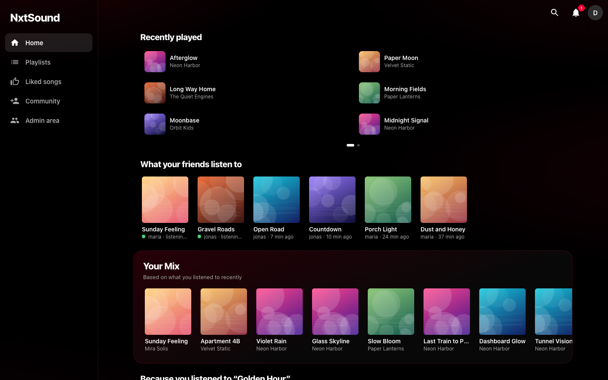

[Quick start](#quick-start) · [Why](#why-nxtsound) · [Features](#features) · [Plugins](#plugins) · [Roadmap](#roadmap) · [Support](#support-the-project) · [Contribute](#contributing) · [Docs](#documentation)

</div>

## Quick start

You need Docker and a folder with music (MP3, FLAC, M4A/AAC, OGG, Opus, WAV, AIFF). Change the two marked lines, paste, done:

```sh
mkdir nxtsound && cd nxtsound
cat > docker-compose.yml <<'EOF'
services:
  nxtsound:
    image: ghcr.io/nxtsound/nxtsound-server:latest
    restart: unless-stopped
    ports: ["8000:8000"]
    environment:
      ADMIN_USER: admin
      ADMIN_PASSWORD: change-me-please                  # <- choose a password (8+ characters)
    volumes:
      - nxtsound-data:/data
      - /path/to/your/music:/music:ro                   # <- your music folder (read-only)
      - ./plugins:/plugins
volumes:
  nxtsound-data:
EOF
docker compose up -d
```

Open <http://localhost:8000>, log in, and give the first scan a moment. That is it.

<details>
<summary><b>No Docker?</b> Run it directly (Python 3.12)</summary>

```sh
git clone https://github.com/nxtsound/nxtsound-server.git && cd nxtsound-server
python3 -m venv .venv && .venv/bin/pip install -r requirements.txt
ADMIN_USER=admin ADMIN_PASSWORD=change-me-please MUSIC_DIR=/path/to/your/music \
  .venv/bin/uvicorn main:app --port 8000
```

`ffmpeg` is optional (DJ analysis), `git` is needed to install plugins from repositories.
</details>

<details>
<summary><b>Prefer building from source with Docker?</b></summary>

```sh
git clone https://github.com/nxtsound/nxtsound-server.git && cd nxtsound-server
cp env.example .env        # set MUSIC_PATH, ADMIN_USER and ADMIN_PASSWORD
docker compose up -d --build
```
</details>

Reaching it from outside your home? Put a reverse proxy with HTTPS in front: [Running it on the internet](docs/user-guide.md#running-it-on-the-internet).
Everything else (adding music, every feature, updating, backups, troubleshooting) is in the [user guide](docs/user-guide.md).

## Why NxtSound?

Streaming subscriptions charge you every month, and what you can listen to depends on licenses that can change tomorrow. Music files you own cost nothing
more and never disappear. But a plain folder has none of the convenience: no good search, no recommendations, no phone app. NxtSound closes that gap.

- **You own everything.** Files stay in your folder, history stays in a small database on your server. Nothing is sent anywhere
  (the few optional internet lookups are listed in the [privacy notes](docs/user-guide.md#privacy) and can be switched off).
- **It feels like a streaming service.** Search as you type, artist and album pages, a home page that learns what you like, playlists, lyrics, a queue you can drag around, radio from any song.
- **It copes with messy libraries.** Missing tags? Artist, album, track and year are read from folder and file names.
- **Made for more than one person.** Every family member gets their own login, history, playlists and recommendations.
- **One container, no setup marathon.** Python and SQLite. No external database, no message queue.
- **Open and extensible.** Other sources (internet radio, your Nextcloud, …) connect as [plugins](PLUGINS.md): separate programs, so the core stays small and you only run what you trust.

## Features

**Ready to use**

- 🎵 **Your library**, even messy: tags, covers, and artist/album/track read from folder and file names
- 🔎 **Instant search**, artist and album pages
- ▶️ **A full player**: queue, shuffle, repeat, synced lyrics, resume where you left off
- 📃 **Playlists and likes**, and a home page that learns what you like (your mix, rediscover, genres, decades)
- 👥 **Multiple users** with an admin area, backup and restore
- 📱 **Installable web app**, English and German

**Alpha** (works, but young: details may change)

🎚 DJ mode · 📊 Recap · 🧩 Plugins · 🌐 Metadata from MusicBrainz · 🔔 Notifications and update notices · 🤝 Community (opt-in) · 🍏 iOS app (in development)

<table>
  <tr>
    <td width="33%">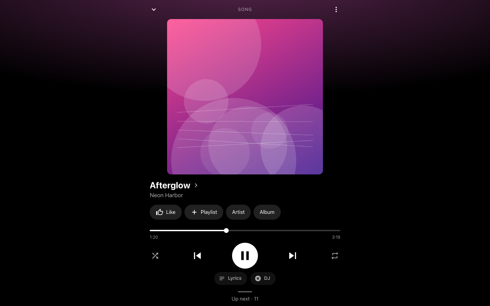</td>
    <td width="33%">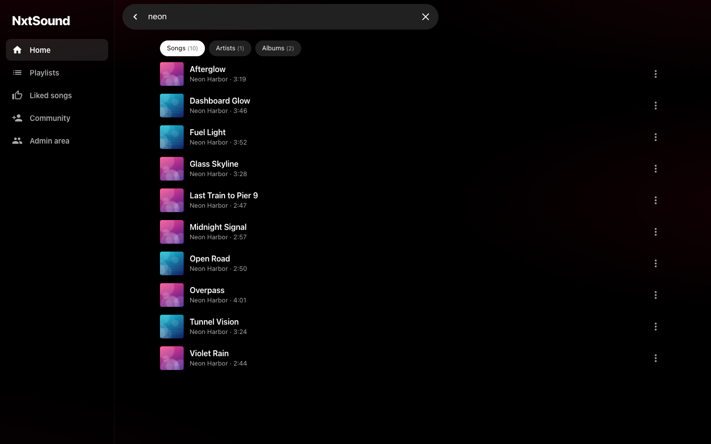</td>
    <td width="33%">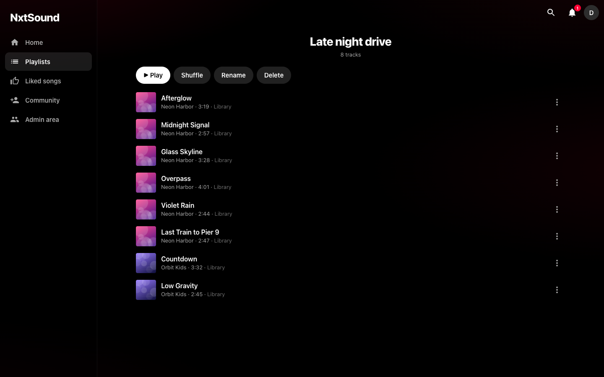</td>
  </tr>
  <tr>
    <td width="33%">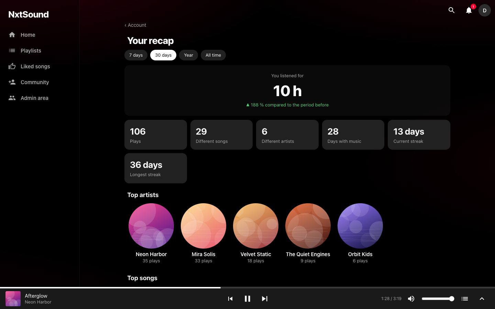</td>
    <td width="33%">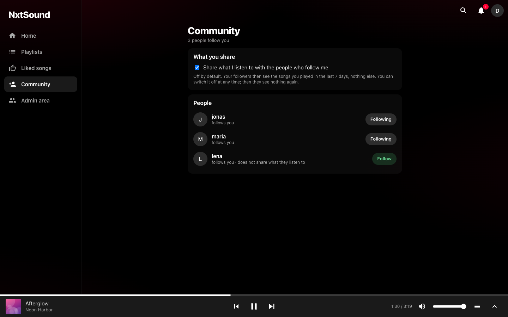</td>
    <td width="33%">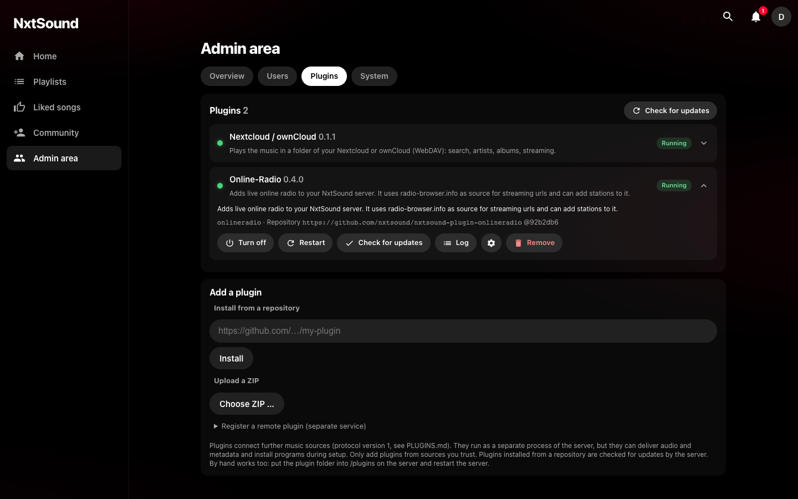</td>
  </tr>
</table>

**On your phone** (the web app adapts; the native iOS app is in development):

<p>
  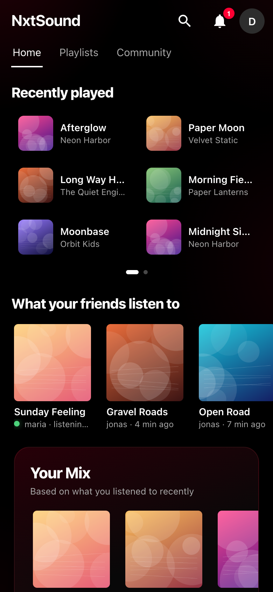
  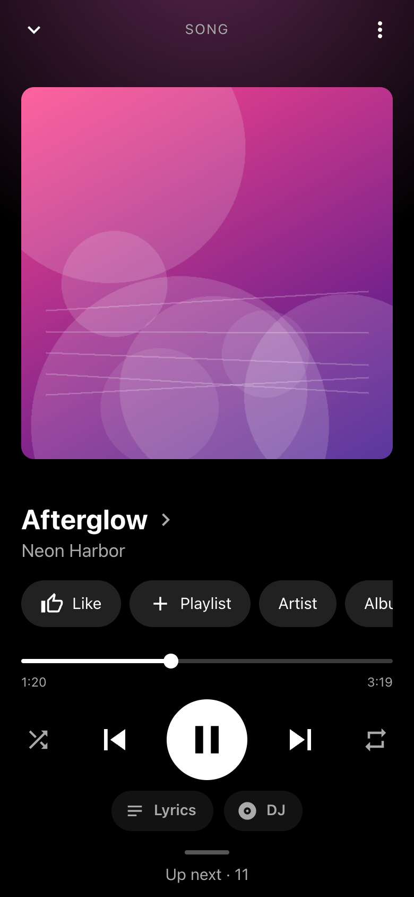
  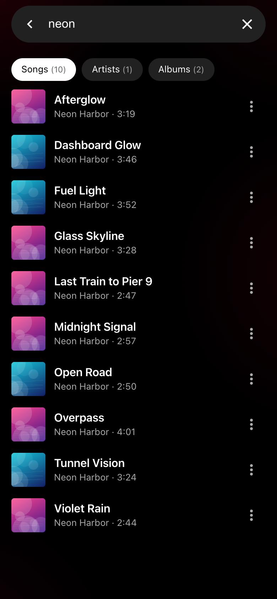
  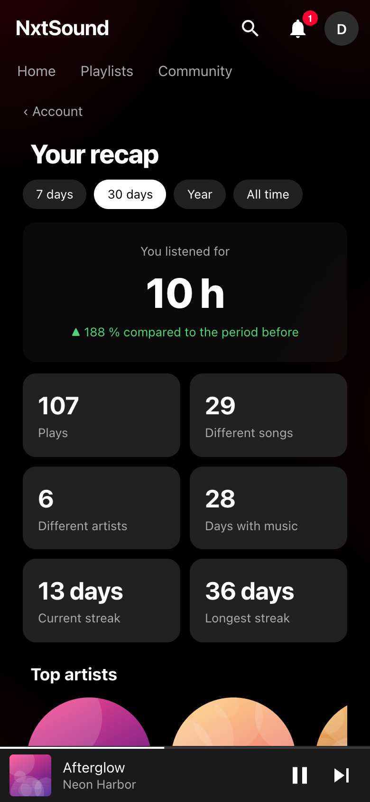
</p>

## Plugins

Music does not have to come from files on your disk. A plugin is a small separate program that adds a source; the server sets it up and starts it,
and its songs show up in search, radio, playlists and recommendations.

**Official plugins** (maintained by this project)

| Plugin | What it does | Status |
|---|---|---|
| [Online radio](https://github.com/nxtsound/nxtsound-plugin-onlineradio) | Live radio stations from radio-browser.info, with the current song | Alpha |
| [Nextcloud / ownCloud](https://github.com/nxtsound/nxtsound-plugin-nextcloud) | The music in a folder of your cloud (WebDAV) | Alpha |

**Community plugins** are written and maintained by others. They are listed in [docs/community-plugins.md](docs/community-plugins.md), which also says what we list and how to add yours.
Want to write one? Start with the [plugin guide](PLUGINS.md) and the runnable template in [`examples/hello-plugin`](examples/hello-plugin).

Plugins run with the rights of the server: only install plugins you trust.

## Roadmap

- **Now:** first public release (0.1.0), collecting feedback on the alpha features.
- **Next:** 🍏 the **iOS app** (built, being tested; TestFlight / App Store) · 🌐 the **project website** (nxtsound.app) with a tour and a live demo.
- **Later:** 🤖 an **Android app** (wanted, see below) · 🧩 a directory of community plugins. Ideas welcome: open an issue.

## Support the project

NxtSound is free and open source (MIT) and developed in spare time. If it brings you joy you can chip in; donations are voluntary and buy no features or priority.

| | |
|---|---|
| ☕ **Buy me a coffee** | <https://buymeacoffee.com/robingl> |
| 💙 **PayPal** | `PAYPAL_LINK_PLACEHOLDER` |

<!-- QR code: add the image as docs/buymeacoffee-qr.png and show it here with  -->

**What donations pay for:** the Apple Developer Program (about 99 USD per year) for the iOS app · the domain, website and a public demo server · test devices (for example for the Android app) · and, if anything is left, time for the project.
No money? A star, a bug report, a translation or a mention to a friend helps just as much.

## Contributing

Contributions are very welcome. Some of the most valuable are not code in this repository:

- 🤖 **An Android app** is the biggest gap. The iOS app is a thin native shell around the web app (background playback, lock screen, offline songs); Android can follow the same idea. If you know Kotlin and want to lead it, open an issue and we plan it together. The server side is ready.
- 🧩 **Plugins** for other music sources · 🌍 **translations** (one JSON file, no code) · 🐛 **bug reports** · 📖 **docs** · 📸 **screenshots**

In short: fork, `pip install -r requirements-dev.txt`, change, `python -m pytest -q tests`, open a pull request.
The step-by-step guide and our rules are in [CONTRIBUTING.md](CONTRIBUTING.md) and the [developer guide](docs/developer-guide.md).

## Documentation

| For | Where |
|---|---|
| Using NxtSound: install, add music, every feature, updates, troubleshooting, privacy | [User guide](docs/user-guide.md) |
| All settings (environment variables) | [Configuration reference](docs/configuration.md) |
| How the code is organized, how to run, test and change it, how to release | [Developer guide](docs/developer-guide.md) |
| Writing a plugin | [Plugin guide](PLUGINS.md) |
| What changed · reporting a vulnerability | [Changelog](CHANGELOG.md) · [Security policy](SECURITY.md) |

## License

[MIT](LICENSE). Third-party services keep their own terms (MusicBrainz, Cover Art Archive, LRCLIB, radio-browser.info).
