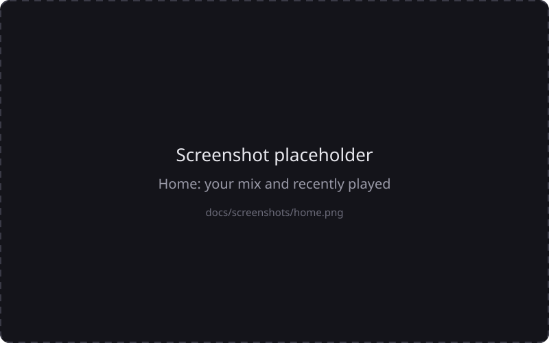
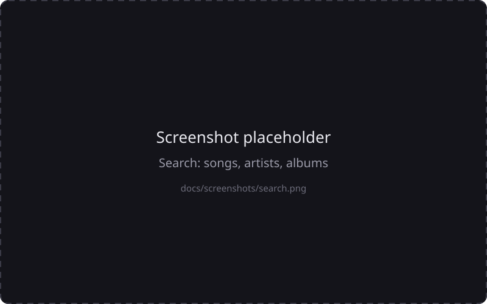
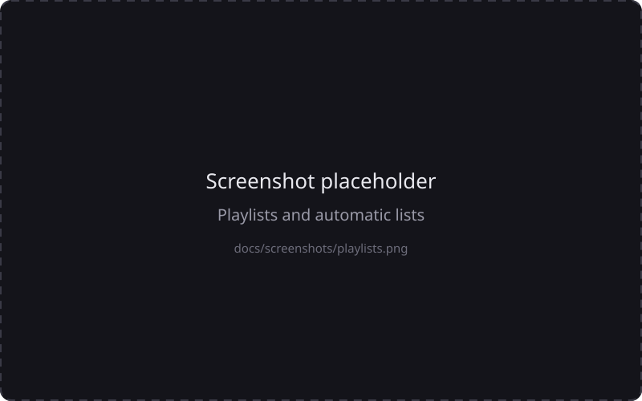
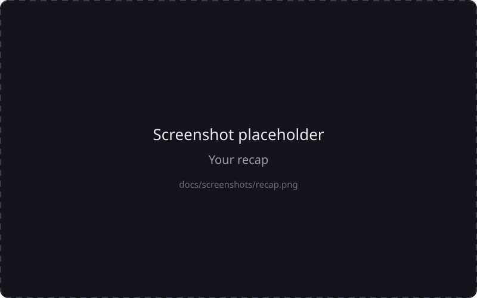
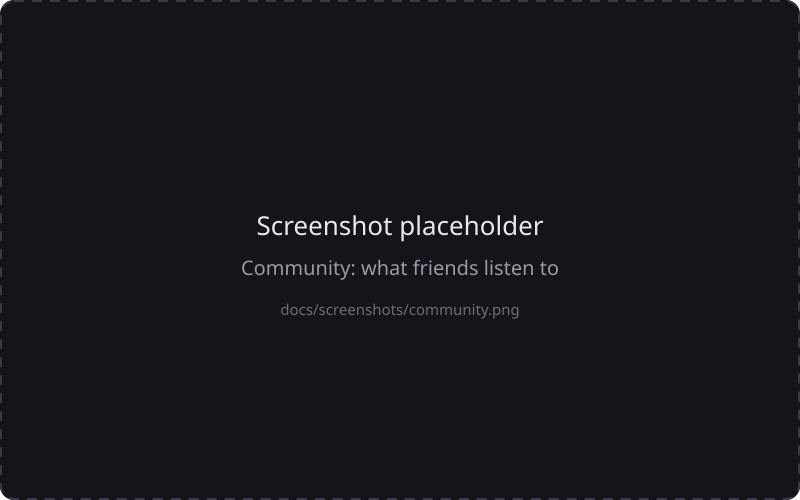
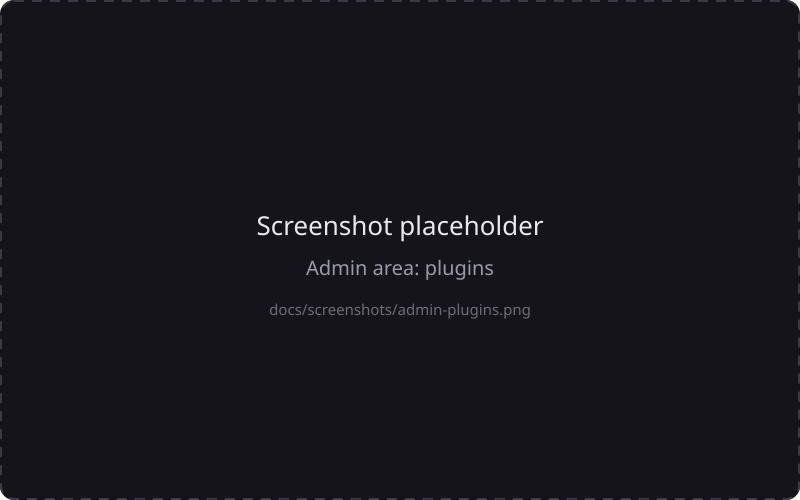

<div align="center">

# NxtSound

**Your music. Your server. No subscription, no tracking.**

A self-hosted music server with a fast web app, smart recommendations and a plugin system.
Point it at a folder of music files, open it in any browser, and it feels like a streaming service that belongs to you.

[](https://github.com/nxtsound/nxtsound-server/actions/workflows/ci.yml)
[](LICENSE)


[Quick start](#quick-start) · [User guide](docs/user-guide.md) · [Developer guide](docs/developer-guide.md) · [Roadmap](#roadmap) · [Contribute](#contributing)

</div>

<p align="center">
  
</p>

---

## Why NxtSound?

Streaming services rent you your own taste back, month after month. A folder of files on your own disk has none of that
convenience: no good search, no recommendations, no phone app. NxtSound closes that gap.

- **You own everything.** Your files stay in your folder, your listening history stays in a small database on your server.
  Nothing is sent to anyone. (The optional extras that do talk to the internet, like cover art lookups, are listed [below](#what-talks-to-the-internet) and can be turned off.)
- **It feels like a streaming service.** Search as you type, artist and album pages, a home page that learns what you like,
  playlists, likes, lyrics, a queue you can drag around, radio from any song.
- **It understands messy libraries.** Missing tags? The server reads artist, album, track number and year from folder and file names.
- **Made for more than one person.** Every family member or flatmate gets their own login, history, playlists and recommendations.
- **One container, no setup marathon.** Python and SQLite, started with `docker compose up`. No external database, no message queue.
- **Open and extensible.** Other music sources (internet radio, your Nextcloud, …) connect as [plugins](PLUGINS.md) that are
  separate programs with a small HTTP protocol, so the core stays small and you only run what you trust.
- **English and German** out of the box, easy to add more languages.

## What it can do

| | Feature | Status |
|---|---|---|
| 🎵 | Library scan with tags, embedded covers, folder images and name-based detection | Stable |
| 🔎 | Instant search for songs, artists and albums; artist and album pages | Stable |
| ▶️ | Web player: queue, shuffle, repeat, drag to reorder, keyboard shortcuts, lyrics, resume position | Stable |
| 📃 | Playlists, likes, listening history, "stop recommending this" | Stable |
| 🏠 | Home page with "Your Mix", "Because you listened to …", automatic lists (most played, rediscover, genres, decades) | Stable |
| 👥 | Multiple users, admin area, password change, backup and restore | Stable |
| 📱 | Installable web app (PWA), mobile friendly | Stable |
| 🌍 | English and German user interface | Stable |
| 🎚 | DJ mode and DJ fit (tempo and key aware radio, beat-matched transitions) | Alpha |
| 📊 | Your recap (week / month / year: minutes, top songs, streaks, …) | Alpha |
| 🧩 | Plugin system (protocol v1) with official plugins for [online radio](https://github.com/nxtsound/nxtsound-plugin-onlineradio) and [Nextcloud / ownCloud](https://github.com/nxtsound/nxtsound-plugin-nextcloud) | Alpha |
| 🌐 | Optional metadata from MusicBrainz and the Cover Art Archive (year, cover, artist description) | Alpha |
| 🔔 | Notification bell, update notices for the server and plugins, disk space warnings | Alpha |
| 🤝 | Community: follow each other and see what friends listen to (opt-in, off by default) | Alpha |
| 🍏 | Native iOS app with lock screen controls and offline songs | In development, not released yet |

**Stable** means it is used every day and covered by tests. **Alpha** means it works but is young: details may still change and
rough edges are expected. Please report what you find.

<table>
  <tr>
    <td></td>
    <td></td>
  </tr>
  <tr>
    <td></td>
    <td></td>
  </tr>
  <tr>
    <td></td>
    <td></td>
  </tr>
</table>

## Quick start

You need Docker with the Compose plugin and a folder with music files (MP3, FLAC, M4A/AAC, OGG, Opus, WAV or AIFF).

```sh
git clone https://github.com/nxtsound/nxtsound-server.git
cd nxtsound-server
cp env.example .env        # set MUSIC_PATH, ADMIN_USER and ADMIN_PASSWORD
docker compose up -d --build
```

Open <http://localhost:8000>, log in with the admin account from `.env`, and wait a moment while the first scan runs.
That is it. More in the [user guide](docs/user-guide.md).

Prefer not to build? Every release is also published as an image:

```yaml
services:
  server:
    image: ghcr.io/nxtsound/nxtsound-server:latest   # or pin a version, e.g. :0.1.0
```

Without Docker you need Python 3.12 and `ffmpeg`:

```sh
python3 -m venv .venv && .venv/bin/pip install -r requirements.txt
MUSIC_DIR=/path/to/music .venv/bin/uvicorn main:app --port 8000
```

Putting it on the internet? Run it behind a reverse proxy with HTTPS and read [Running it safely](docs/user-guide.md#running-it-on-the-internet).

## What talks to the internet

By default the server only talks to the internet in these cases. Every one of them can be switched off.

| What | Why | Switch off |
|---|---|---|
| `api.github.com` | looks for a newer NxtSound release and for newer versions of plugins you installed from a repository (it never updates anything by itself) | `UPDATE_CHECK_HOURS=0` |
| MusicBrainz, Cover Art Archive | fills in missing year, cover and artist description (only artist and album names are sent) | `ENRICH=0` |
| lrclib.net | song lyrics (only the song title, artist, album and length are sent) | `LYRICS=0` |
| Plugins you install | whatever the plugin does (for example the radio plugin asks radio-browser.info) | do not install them |

## Plugins

Music does not have to come from files on your disk. A plugin is a small separate program that adds a music source. The server
installs it into its own environment, starts it, and makes its songs show up in search, radio, playlists and recommendations next to your own files.

- [Online radio](https://github.com/nxtsound/nxtsound-plugin-onlineradio): live radio stations from radio-browser.info, with the current song.
- [Nextcloud / ownCloud](https://github.com/nxtsound/nxtsound-plugin-nextcloud): the music in a folder of your cloud (WebDAV).
- Your own: start from the [plugin guide](PLUGINS.md) and the runnable template in [`examples/hello-plugin`](examples/hello-plugin).

Plugins run with the rights of the server: only install plugins you trust. Admins can switch installation off.

## Roadmap

**Now: first public release (0.1.0)**
- Polish the documentation, screenshots and the project's GitHub setup.
- Collect feedback on the alpha features and fix what breaks.

**Next**
- 🍏 **iOS app**: the native app (lock screen, background playback, offline songs) is built and being tested; release via TestFlight / App Store.
- 🌐 **Project website** (nxtsound.app) with a short tour, the docs and a live demo.
- 📚 More documentation: video walkthrough, FAQ from real questions.

**Later**
- 🤖 **Android app**: wanted, and a great place to contribute (see below).
- 🧩 A directory of community plugins (finding and installing plugins from the admin area).
- Ideas welcome: open an issue with the label `idea`.

## Support the project

NxtSound is free and open source (MIT) and developed in spare time. If it brings you joy, you can chip in. Donations are
voluntary and do not buy features or priority; they just keep the project going.

| | |
|---|---|
| ☕ **Ko-fi** | `KOFI_LINK_PLACEHOLDER` |
| 💙 **PayPal** | `PAYPAL_LINK_PLACEHOLDER` |

**What donations pay for**
- the Apple Developer Program (about 99 USD per year) that is needed to publish the iOS app,
- the domain and hosting of the project website and a public demo server,
- test devices and infrastructure (for example Android devices once the Android app starts),
- and, if there is something left, time to work on the project.

No money? A star on GitHub, a bug report, a translation or a mention to a friend helps just as much.

## Contributing

Contributions are very welcome, and some of the most valuable ones are not code in this repository:

- 🤖 **An Android app** is the biggest gap. The iOS app is a thin native shell around the web app that adds what a browser cannot do
  (background playback, lock screen controls, offline songs); an Android app can follow the same idea. If you know Kotlin and want to
  lead this, open an issue and let us plan it together. The server side (API version, `/api/server-info`, offline set) is ready for it.
- 🧩 **Plugins** for other music sources (see the [plugin guide](PLUGINS.md)).
- 🌍 **Translations**: one JSON file per language, no code needed ([how](docs/developer-guide.md#translations)).
- 🐛 **Bug reports** with the server version and a log excerpt, **documentation fixes**, **screenshots**.

How to get started, in short: fork the repository, `pip install -r requirements-dev.txt`, make your change, run
`python -m pytest -q tests`, and open a pull request. The full guide, including the rules we follow, is in
[CONTRIBUTING.md](CONTRIBUTING.md) and the [developer guide](docs/developer-guide.md).

## Documentation

| For | Where |
|---|---|
| Using NxtSound: install, add music, every feature, updates, troubleshooting | [User guide](docs/user-guide.md) |
| All settings (environment variables) | [Configuration reference](docs/configuration.md) |
| How the code is organized, how to run and test it, how to change it | [Developer guide](docs/developer-guide.md) |
| Writing a plugin | [Plugin guide](PLUGINS.md) |
| What changed | [Changelog](CHANGELOG.md) |
| Reporting a vulnerability | [Security policy](SECURITY.md) |

## License

[MIT](LICENSE). Third-party services and libraries keep their own terms (MusicBrainz, Cover Art Archive, LRCLIB, radio-browser.info).
